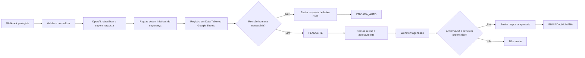

# AI Operations — Triagem Inteligente de Solicitações

Automação empresarial para receber solicitações de suporte, classificá-las com IA, encaminhar casos sensíveis para aprovação humana e registrar o resultado.

> **Diferença entre a implantação e os exports:** a instância n8n validada usa Data Tables e um agendamento para processar aprovações. Os JSON em `workflows/` são templates alternativos de Google Sheets/Google Sheets Trigger, não exports idênticos da instância publicada. Importe-os apenas em uma instância de teste ou ao optar por essa variante.

## Entregáveis

- **Parte teórica:** [Parte Teórica — Arquitetura da Automação (PDF)](docs/Parte%20Teorica.pdf).
- **Parte prática:** workflows n8n em [`workflows/`](workflows/) e dados de teste sintéticos em [`examples/`](examples/).
- **README:** este documento descreve problema, arquitetura, ferramentas, IA, integrações e como testar/compreender o fluxo.
- **Evidências:** as execuções ponta a ponta foram validadas, mas as capturas reais redigidas ainda precisam ser adicionadas.
- **Vídeo pitch:** gravação e link acessível ainda pendentes.

## Problema e solução

Solicitações de suporte chegam em texto livre e exigem leitura, classificação, priorização, resposta e registro manual. Isso aumenta o retrabalho e dificulta a rastreabilidade. A automação trata casos rotineiros e mantém uma pessoa responsável por decisões sensíveis.

## Ferramentas e integrações

- **n8n:** orquestração, validações, regras e persistência.
- **OpenAI API (`gpt-4o-mini`):** classificação, resumo e sugestão de resposta em JSON.
- **Data Tables:** persistência usada pela implantação validada; **Google Sheets:** alternativa representada pelos templates versionados.
- **SMTP:** envio de respostas.
- **Cloudflare Tunnel e Access:** publicação e controle de acesso da instância n8n.
- **Cloudflare Worker e Turnstile:** formulário público temporário usado na demonstração; o código do formulário não faz parte deste conjunto mínimo.

## Papel da IA e supervisão humana

O modelo recebe somente o texto da solicitação — não recebe nome nem e-mail — e sugere categoria, prioridade, confiança, resumo e resposta. Regras determinísticas prevalecem sobre a saída da IA. Pagamento, privacidade, questões jurídicas, urgência, baixa confiança, falha ou resposta inválida exigem revisão humana. O envio automático fica restrito a casos de baixo risco.

Casos sensíveis ficam `PENDENTE`. Uma pessoa autorizada registra `reviewer` e muda o estado para `APROVADA` ou `REJEITADA`. O workflow de aprovação só envia quando há aprovação explícita e revisor identificado.

## Como testar os templates versionados

1. Use uma instância de teste do n8n. Crie uma planilha Google com uma aba `Solicitacoes` e os cabeçalhos de [`examples/cabecalho-planilha.csv`](examples/cabecalho-planilha.csv).
2. Importe os dois JSON de [`workflows/`](workflows/). Não os importe por cima dos workflows ativos da implantação Data Tables.
3. Configure credenciais próprias no n8n para Google Sheets, OpenAI, SMTP e Header Auth do webhook. Não coloque credenciais nos JSON, em exemplos, prints ou no Git.
4. Ative primeiro `02 - Aprovação Human-in-the-Loop` e depois `01 - Triagem de Solicitações`.
5. Envie os payloads de [`examples/`](examples/) ao webhook de teste do n8n. O primeiro representa baixo risco; o segundo deve ficar pendente para revisão humana.

Os payloads são fictícios. A validação local anterior confirmou a estrutura dos exports e suas regras; a execução dos JSON exige credenciais e serviços configurados na sua própria instância.

## Demonstração publicada e segurança

A demonstração temporária do formulário está em <https://ai-operations-intake-demo.gabriel-drtroll.workers.dev> e tem expiração configurada para `2026-12-16T00:21:20Z` (UTC). Ela encaminha solicitações para a implantação n8n validada, usando o destinatário de teste fixo no servidor. Os envios criam registros reais na Data Table e solicitações simples podem enviar e-mail; use **somente dados sintéticos** e evite testes repetidos.

As credenciais ficam em armazenamentos server-side/n8n, não no navegador nem neste repositório. O editor n8n deve permanecer protegido por Cloudflare Access e o webhook por autenticação própria. Não crie bypass amplo. `.env.local`, arquivos `.dev.vars`, caches Wrangler e dependências locais são ignorados pelo Git.

## Status da entrega

- Fluxos de baixo risco e de aprovação humana foram validados ponta a ponta; recebimento dos e-mails de teste foi confirmado.
- **Pendente:** adicionar capturas reais dos workflows e dos registros, ocultando dados pessoais, IDs e credenciais. Não use imagens simuladas.
- **Pendente:** gravar o pitch (até 4 minutos), publicá-lo em uma plataforma acessível e substituir esta linha pelo link: **[inserir link do vídeo]**.
